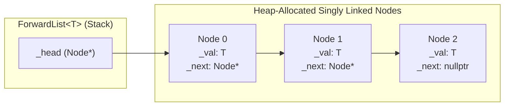

# ForwardList — Custom STL-Compatible Singly Linked List in C++


A header-only generic C++ implementation of a singly linked list (`ForwardList<T>`), developed as part of a university **Data Structures** course. Modeled after `std::forward_list<T>` from the C++ Standard Template Library (STL), `ForwardList<T>` provides minimal memory overhead (a single head pointer per container and one `_next` pointer per node) and $O(1)$ front insertion and removal.

---

## Table of Contents

- [Overview](#overview)
- [Key Technical Features](#key-technical-features)
- [Memory Layout & Pointer-to-Pointer Idiom](#memory-layout--pointer-to-pointer-idiom)
- [Project Structure](#project-structure)
- [API Reference & Complexity](#api-reference--complexity)
- [Code Examples](#code-examples)
- [Test Suite (TDD)](#test-suite-tdd)
- [Building & Running](#building--running)
- [Author](#author)

---

## Overview

Unlike doubly linked lists (`std::list`) or dynamic arrays (`std::vector`), a singly linked list optimizes for strict space efficiency and $O(1)$ head mutations (`push_front`, `emplace_front`, `pop_front`). Each node stores only its value (`_val`) and a pointer to the next node (`_next`), while the `ForwardList<T>` object itself consists solely of a single `Node* _head` pointer (`sizeof(ForwardList<T>) == sizeof(void*)`).

The container is implemented in [`ForwardList/ForwardList.h`](ForwardList/ForwardList.h) and tested through the modular unit test suites in [`ForwardList/Tests/`](ForwardList/Tests/).

---

## Key Technical Features

- **Zero Container Overhead**
  - `ForwardList<T>` stores only `Node* _head`, matching the compact footprint of `std::forward_list`.
- **Linus Torvalds' Pointer-to-Pointer (`Node**`) Construction Idiom**
  - Rather than branching on `if (_head == nullptr)` or maintaining a separate `tail` pointer during list construction and deep copying, `ForwardList<T>` uses a `Node** curNode = &_head` cursor:
    ```cpp
    Node** curNode = &_head;
    while (sourceNode != nullptr)
    {
        *curNode = new Node(sourceNode->_val);
        curNode = &(*curNode)->_next;
        sourceNode = sourceNode->_next;
    }
    ```
  - This constructs N-element lists in a single $O(N)$ forward pass with zero special-case branching for the head node.
- **STL-Style Forward Iterators (`iterator` & `const_iterator`)**
  - Defines standard iterator traits (`value_type`, `difference_type`, `pointer`, `reference`, `iterator_category = std::forward_iterator_tag`).
  - Supports dereferencing (`*it`), member access (`it->member`), prefix/postfix increment (`++it`, `it++`), equality/inequality (`==`, `!=`), and seamless conversion between `iterator` and `const_iterator`.
- **In-Place Front Emplacement (`emplace_front`)**
  - Variadic template `emplace_front(Args&&... args)` forwards arguments via `std::forward<Args>(args)...` to construct and prepend elements in $O(1)$ time.
- **Deterministic Resource Cleanup**
  - Destructor (`~ForwardList()`) and `clear()` iteratively traverse and deallocate every `Node` in $O(N)$ time with $O(1)$ auxiliary stack space (avoiding recursion depth limits on large lists).

---

## Memory Layout & Pointer-to-Pointer Idiom



---

## Project Structure

```text
ForwardList/
├── ForwardList.sln                                         # Visual Studio 2022 Solution
├── .gitignore                                              # Visual Studio & build artifact ignores
├── README.md                                               # Project documentation
│
└── ForwardList/
    ├── ForwardList.h                                       # Generic ForwardList<T> & iterator implementation
    ├── main.cpp                                            # Test runner entry point
    ├── ForwardList.vcxproj                                 # MSVC project configuration (v143)
    ├── ForwardList.vcxproj.filters                         # Solution Explorer filters
    │
    └── Tests/                                              # Modular TDD Test Suites
        ├── 1BasicConstructorsTest.h                        # Default, sized, and value-fill constructors
        ├── 2PushFrontTest.h                                # push_front() insertion order verification
        ├── 3PopFrontTest.h                                 # pop_front() removal and empty() state
        ├── 4DestructorCallTest.h                           # Destructor invocation count tracker
        ├── 5CopyConstructorTest.h                          # Deep copy construction & mutation isolation
        ├── 6AssignmentOperatorTest.h                       # Copy assignment operator & deep equality
        ├── 7DestructorWithAssignmentTest.h                 # Node destruction check during assignment
        ├── 8EmplaceFrontTest.h                             # Variadic emplace_front() with multiple constructors
        ├── 9FrontTest.h                                    # Mutable & const front() access
        ├── 10ClearTest.h                                   # clear() deallocation and reuse
        ├── 11BasicIteratorTest.h                           # Forward iterator traversal & mutation
        ├── 12ConstIteratorTest.h                           # const_iterator traversal on const ForwardList
        ├── 13MemberAccessIteratorTest.h                    # operator->() on struct/class elements
        ├── 14InitializerListConstructorTest.h              # std::initializer_list<T> construction
        ├── 15IteratorConstructibleTest.h                   # Input-iterator range construction suite
        ├── 16ClassWithNoDefaultConstructorTest.h           # Non-default-constructible element suite
        ├── 17InsertTest.h                                  # insert_after() test suite
        ├── 18EraseTest.h                                   # erase_after() test suite
        ├── 19StlCompatibilityTest.h                        # STL <algorithm> compatibility suite
        └── Fixtures/
            └── CustomAsserts.h                             # Test assertion macros & diagnostics
```

---

## API Reference & Complexity

### Constructors, Destructor & Assignment

| Member | Signature | Time Complexity | Description |
| :--- | :--- | :---: | :--- |
| **Default / Fill Ctor** | `ForwardList(size_t size = 0, const T& val = T())` | $O(N)$ | Creates a list of `size` nodes initialized to `val`. |
| **Copy Ctor** | `ForwardList(const ForwardList& source)` | $O(N)$ | Deep-copies all nodes from `source` preserving order. |
| **Initializer List Ctor** | `ForwardList(std::initializer_list<T> initList)` | $O(N)$ | Constructs a list with the elements of `initList`. |
| **Destructor** | `~ForwardList()` | $O(N)$ | Iteratively deletes all nodes in the list. |
| **Copy Assignment** | `ForwardList& operator=(const ForwardList& source)` | $O(N + M)$ | Destroys current nodes and deep-copies `source`. |

### Element Access, Iterators & Modifiers

| Method | Signature | Time Complexity | Description |
| :--- | :--- | :---: | :--- |
| `front` | `T& front()` / `const T& front() const` | $O(1)$ | Returns a reference to the first element (`_head->_val`). |
| `empty` | `bool empty() const` | $O(1)$ | Returns `true` if `_head == nullptr`. |
| `push_front` | `void push_front(const T& val)` | $O(1)$ | Allocates a new node and links it at `_head`. |
| `emplace_front` | `template <typename... Args>`<br>`void emplace_front(Args&&... args)` | $O(1)$ | Forwards `args...` to construct an element at the front. |
| `pop_front` | `void pop_front() noexcept` | $O(1)$ | Unlinks and deletes the head node. |
| `clear` | `void clear()` | $O(N)$ | Deletes all nodes and resets `_head = nullptr`. |
| `begin` / `end` | `iterator begin()`, `iterator end()`<br>`const_iterator begin() const`, `const_iterator end() const` | $O(1)$ | Returns forward iterators to `_head` and `nullptr`. |
| `operator==` / `!=` | `bool operator==(const ForwardList<U>&, const ForwardList<U>&)` | $O(N)$ | Element-by-element equality and length comparison. |

---

## Code Examples

```cpp
#include "ForwardList/ForwardList.h"
#include <iostream>

struct Point
{
    int x = 0;
    int y = 0;
    Point(int x = 0, int y = 0) : x(x), y(y) {}
};

int main()
{
    ForwardList<int> list = { 10, 20, 30 };
    list.push_front(5);

    for (auto it = list.begin(); it != list.end(); ++it)
        std::cout << *it << " "; // Output: 5 10 20 30
    std::cout << "\n";

    ForwardList<Point> points;
    points.emplace_front(3, 4);
    points.emplace_front(1, 2);

    std::cout << "First point: (" << points.begin()->x << ", " << points.begin()->y << ")\n";
    return 0;
}
```

---

## Test Suite (TDD)

The test runner in [`ForwardList/main.cpp`](ForwardList/main.cpp) executes the static-initialization test suites (`Tests 1–14` active by default, with `Tests 15–19` included in [`ForwardList/Tests/`](ForwardList/Tests/) for extended operations):

| # | Test File | Verified Behavior |
| :-: | :--- | :--- |
| **1** | [`1BasicConstructorsTest.h`](ForwardList/Tests/1BasicConstructorsTest.h) | Default, sized, and value-fill constructors + `empty()`. |
| **2** | [`2PushFrontTest.h`](ForwardList/Tests/2PushFrontTest.h) | Sequential `push_front()` calls and LIFO head ordering. |
| **3** | [`3PopFrontTest.h`](ForwardList/Tests/3PopFrontTest.h) | `pop_front()` node removal down to an empty list. |
| **4** | [`4DestructorCallTest.h`](ForwardList/Tests/4DestructorCallTest.h) | Exact `~T()` call count verification when `ForwardList` leaves scope. |
| **5** | [`5CopyConstructorTest.h`](ForwardList/Tests/5CopyConstructorTest.h) | Deep copy construction and `operator==` / `operator!=`. |
| **6** | [`6AssignmentOperatorTest.h`](ForwardList/Tests/6AssignmentOperatorTest.h) | Copy assignment between lists of different sizes. |
| **7** | [`7DestructorWithAssignmentTest.h`](ForwardList/Tests/7DestructorWithAssignmentTest.h) | Verifies old nodes are properly destroyed when overwritten by `operator=`. |
| **8** | [`8EmplaceFrontTest.h`](ForwardList/Tests/8EmplaceFrontTest.h) | Variadic `emplace_front()` with 0, 2, and 3 constructor arguments. |
| **9** | [`9FrontTest.h`](ForwardList/Tests/9FrontTest.h) | Reading and mutating the head element via `front()` and `const front()`. |
| **10** | [`10ClearTest.h`](ForwardList/Tests/10ClearTest.h) | `clear()` followed by `empty()` verification. |
| **11** | [`11BasicIteratorTest.h`](ForwardList/Tests/11BasicIteratorTest.h) | Traversal and in-place element modification via `ForwardList::iterator`. |
| **12** | [`12ConstIteratorTest.h`](ForwardList/Tests/12ConstIteratorTest.h) | Read-only traversal via `ForwardList::const_iterator`. |
| **13** | [`13MemberAccessIteratorTest.h`](ForwardList/Tests/13MemberAccessIteratorTest.h) | Calling member methods via `it->method()` (`operator->`). |
| **14** | [`14InitializerListConstructorTest.h`](ForwardList/Tests/14InitializerListConstructorTest.h) | Construction from `std::initializer_list<T>`. |

---

## Building & Running

### Option 1: Visual Studio 2022

1. Open `ForwardList.sln` in **Visual Studio 2022**.
2. Select **Debug / x64** or **Release / x64**.
3. Build (`Ctrl + Shift + B`) and run (`Ctrl + F5`).

### Option 2: Command-Line Compilation (MSVC / GCC / Clang)

**MSVC:**
```powershell
cl /EHsc /std:c++20 /W3 ForwardList\main.cpp /Fe:forward_list_tests.exe
.\forward_list_tests.exe
```

**GCC / Clang:**
```bash
g++ -std=c++20 -Wall -Wextra ForwardList/main.cpp -o forward_list_tests
./forward_list_tests
```

**Expected Output:**
```text
All tests passed
```

---

## Author

- **Davit Bakhshyan** — [@DavitBakh](https://github.com/DavitBakh)
